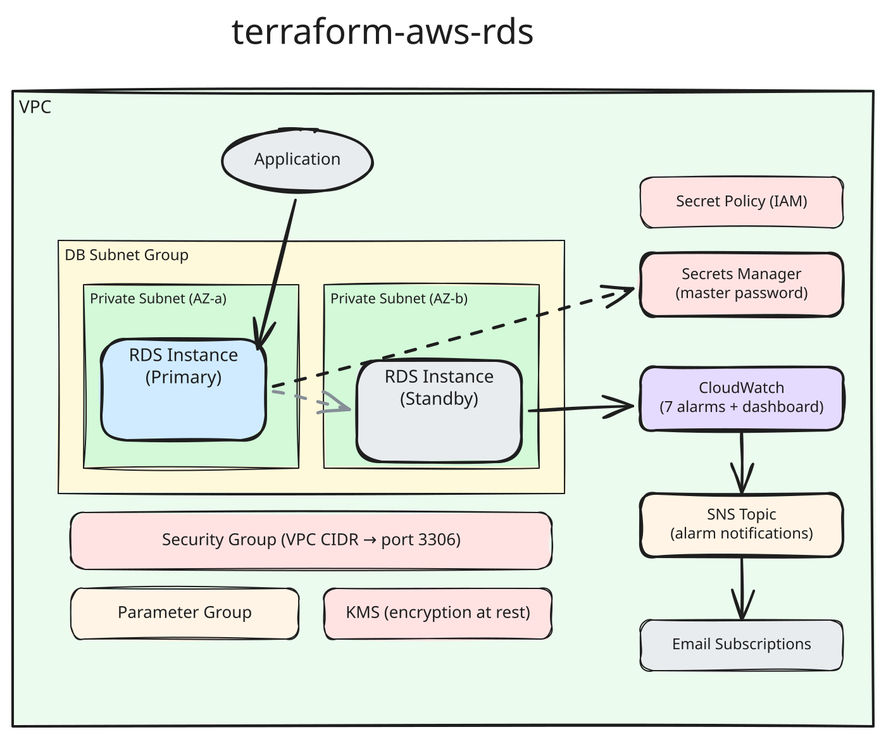

# Architecture

## How It Works

## Design Decisions

### Performance Insights Always On

PI is hardcoded to enabled because:

- The 7-day retention is free on supported instance classes
- It's essential for diagnosing production issues
- The module defaults to `db.t4g.medium`, the smallest PI-compatible class for MySQL 8.4 and PostgreSQL 18

### Severity-Based Alarm Routing

Alarms are categorized by operational impact:

| Severity | Alarms | Default Response |
|----------|--------|-----------------|
| **Urgent** | Storage < 5% | Immediate action required |
| **High** | CPU > 80%, Memory < 5%, Storage < 10%, Connections near max, lock table full | Investigate within hours |

The connections alarm fires at 80% of the engine's default `max_connections`, estimated from instance memory:
`memory / 12582880` for MySQL and `LEAST(memory / 9531392, 5000)` for PostgreSQL. Override it with
`alarm_connections_threshold` if you change `max_connections`.
| **Normal** | Storage < 20%, Disk queue depth | Awareness, plan remediation |

### Auto-Created SNS Topic

When users don't provide explicit SNS topic ARNs, the module creates one topic and subscribes
all `alarm_emails`. This ensures alarms are never silent — a common misconfiguration when
teams set up monitoring but forget to wire up notifications.

The topic is encrypted with a customer-managed KMS key. CloudWatch can't publish to a topic under the
AWS-managed `alias/aws/sns` key, whose policy doesn't let it and can't be changed. The key's policy lets
`cloudwatch.amazonaws.com` use it (`kms:Decrypt`, `kms:GenerateDataKey*`) for the module's alarms only, named by
ARN in `local.alarm_names`: an alarm missing there can't reach the topic. A caller passing `notifications` gets
no key; its topics are its own.

### PostgreSQL's Lock Table

PostgreSQL keeps table and advisory locks in one shared lock table, about `max_locks_per_transaction` ×
`max_connections` entries for the whole server. A transaction that takes more fills it, and every session that
needs a lock then fails with "out of shared memory" (SQLSTATE 53200). No RDS or Performance Insights metric
reports how full the table is, so the module counts the error in PostgreSQL's log:

- A metric filter on `/aws/rds/instance/<identifier>/postgresql` counts each error line, ERROR or FATAL, once:
  not the HINT and STATEMENT lines that follow it.
- The alarm fires on one error in 5 minutes, through the high severity. A quiet log is healthy: missing data
  doesn't breach.
- RDS creates the log group itself, while it creates the instance. The module reads it with a data source
  instead of creating it, so an existing instance's group works as is and keeps its retention.

MySQL gets no such alarm.

### One Module, Two Engines

`engine` selects MySQL or PostgreSQL. Everything that differs between them lives in one per-engine map in
`locals.tf`: default version, port, master username, parameter group family, CloudWatch log exports,
the parameters the module sets, and the `max_connections` formula. The subnet group, instance settings,
security group, secrets, Enhanced Monitoring, alarms, and SNS wiring are shared.

| | MySQL | PostgreSQL |
|---|---|---|
| Default version | `8.4` | `18` |
| Port | `3306` | `5432` |
| Master username | `admin` | `postgres` |
| Log exports | `error`, `slowquery` | `postgresql`, `upgrade` |
| Slow query logging | `long_query_time` | `log_min_duration_statement` |
| Lock table alarm | — | "out of shared memory" in the `postgresql` log |

### Parameter Group Family Derivation

The parameter group family is automatically derived from `engine` and `engine_version`:
`mysql` + major.minor (`8.4.3` → `mysql8.4`) and `postgres` + major (`18.6` → `postgres18`).
This prevents the common misconfiguration where someone upgrades the engine version but forgets
to update the parameter group family.

### Managed Master Password

The module uses `manage_master_user_password = true`, which means:

- AWS creates and manages the password in Secrets Manager
- The password is never exposed in Terraform state
- Automatic rotation is handled by RDS
- Access to the secret is controlled via `secret_readers` variable

### Storage Encryption

Always enabled (`storage_encrypted = true`). Uses AWS-managed key by default,
or a customer-managed KMS key if `kms_key_id` is provided.

## CloudWatch Dashboard

Each engine gets its own Performance Insights panels, followed by the same system panels.

**MySQL** (PMM-style):

1. **Header** — QPS, Free Storage, Threads Running, Connections
2. **Connections** — Threads_connected with max_connections line, Aborted connections
3. **Client Threads** — Running vs Connected/Created
4. **Temporary Objects** — tmp_tables vs tmp_disk_tables, Slow queries
5. **Select Types** — full_join, scan, range
6. **Sorts** — rows, merge_passes, scan
7. **Table Locks** — immediate vs waited, Questions & Queries
8. **InnoDB Row Operations** — rows read/inserted/updated/deleted
9. **InnoDB Transactions** — active transactions and history list length
10. **Buffer Pool & Table Cache** — hit rate, usage, opened tables

**PostgreSQL**:

1. **Header** — Commits per second, Free Storage, Active Transactions, Connections
2. **Connections** — numbackends with max_connections line, connection attempts per minute
3. **Transactions** — commits vs rollbacks; active, blocked, and idle-in-transaction sessions
4. **Tuples & Deadlocks** — tuples returned/fetched/inserted/updated/deleted, deadlocks
5. **Buffer Cache & Read Time** — blocks hit in cache vs read from disk, time spent reading blocks
6. **Checkpoints** — timed vs requested, write and sync time
7. **Temporary Files & Transaction ID Age** — temp files and bytes; unvacuumed transactions and
   oldest running transaction age (wraparound risk)
8. **Lock Table Errors** — "out of shared memory" errors per 5 minutes, the lock table alarm's metric

**Both engines**:

1. **Network & IOPS** — throughput and read/write IOPS
2. **CPU & Memory** — utilization with alarm thresholds
3. **Disk Queue & Storage** — queue depth and free space with alarm thresholds (in GiB)
4. **Read/Write Latency** — I/O latency

The system panels start on a row of their own, below the engine's panels.

Metric math keeps its input's unit, so the storage and memory panels, which divide bytes to GiB or MiB, hide the
unit (`showUnits = false`) rather than show "15.4 byte". Performance Insights reports
`db.User.total_auth_attempts` as a running total, so the connection attempts panel plots `RATE()` of it, times 60.
The total starts again when the instance restarts or fails over, and the panel drops that one negative point.

All PI-based widgets use `DB_PERF_INSIGHTS` math expressions, which require the instance
to have Performance Insights enabled. Counter names follow the AWS
[Performance Insights counter metrics][pi-counters]
reference, except for the PostgreSQL checkpoint counters. Those use the PostgreSQL 17+ names
(`db.Checkpoint.num_timed`, `db.Checkpoint.write_time`, ...) that a postgres 18 instance reports, so on
PostgreSQL 16 and older the checkpoint panels stay empty.

[pi-counters]: https://docs.aws.amazon.com/AmazonRDS/latest/UserGuide/USER_PerfInsights_Counters.html
